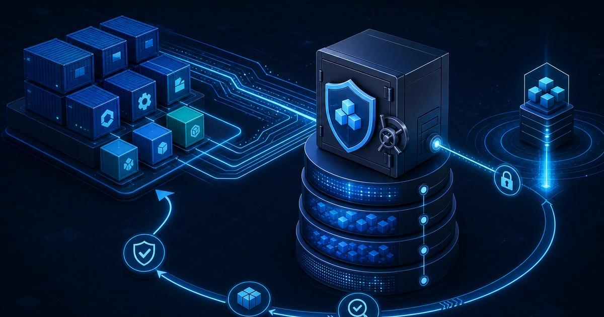

[](LICENSE)
[](https://www.gnu.org/software/bash/)




# Система резервного копирования каталогов пользователя на удалённый SMB сервер - Backup Manager

**Backup Manager** — локальное веб-приложение для настройки и управления резервным копированием каталогов на сетевые ресурсы SMB/CIFS. Приложение объединяет веб-интерфейс, локальный API и фоновое выполнение заданий на Linux.

Вместо ручного запуска команд администратор настраивает источники, параметры SMB и расписание в одном интерфейсе, запускает копирование по запросу и просматривает историю операций.

## Возможности

- **Задания резервного копирования.** Создание, редактирование, включение и удаление заданий; запуск вручную.
- **Расписание.** Автоматический запуск заданий каждый час, ежедневно или еженедельно.
- **SMB/CIFS.** Сохранение параметров сервера и общего ресурса, проверка подключения и автоматическое монтирование при выполнении задания.
- **Копирование через `rsync`.** Настройка сжатия, ограничения пропускной способности, повторных попыток и удаления файлов, отсутствующих в источнике.
- **Мониторинг.** Просмотр состояния заданий и журнала событий в веб-интерфейсе.
- **Локальное хранение.** Настройки, задания и журнал сохраняются backend на компьютере, где запущен сервис.

Задания выполняются последовательно. Каждый набор данных копируется в отдельный каталог внутри настроенной точки монтирования. Удаление файлов назначения, отсутствующих в источнике, выключено по умолчанию.

## Как это работает

1. В веб-интерфейсе задаются каталог-источник, параметры SMB/CIFS и расписание.
2. Backend сохраняет конфигурацию локально и при запуске задания проверяет и монтирует сетевой ресурс.
3. `rsync` копирует данные в каталог задания на ресурсе.
4. Результат выполнения и диагностические сообщения отображаются в журнале.

В production-сборке React-интерфейс обслуживается Nginx, который передаёт запросы API локальному Node.js backend. API и Nginx привязаны к loopback-интерфейсу; приложение рассчитано на работу на том же компьютере, где выполняются резервные копии.

## Технологии

- React, TypeScript и Vite — веб-интерфейс.
- Node.js — локальный API, хранение данных, расписание и очередь заданий.
- `rsync`, `smbclient` и CIFS mount utilities — проверка SMB и копирование на Linux.
- systemd и Nginx — запуск и публикация локального интерфейса в Linux-пакетах.

## Требования и поддержка платформ

Для разработки и сборки интерфейса необходимы Node.js 18 или новее и npm.

Для проверки SMB и выполнения копирования необходим Linux с установленными `rsync`, `smbclient` и CIFS mount utilities. Для монтирования ресурса нужны соответствующие системные привилегии; установленный API-сервис запускается от root.

На Windows интерфейс и backend можно запустить для разработки и сохранения конфигурации, но проверка SMB и выполнение резервного копирования не поддерживаются. Текущая системная интеграция предназначена для Linux. Кроссплатформенная поддержка, включая отдельную ветку для Astra Linux, рассматривается как направление дальнейшего развития.

## Разработка

Установите зависимости:

```bash
npm install
```

Запустите backend и frontend в отдельных терминалах:

```bash
npm run dev:backend
npm run dev
```

Интерфейс разработки будет доступен по адресу `http://127.0.0.1:3000`, API — `http://127.0.0.1:3001`. По умолчанию backend сохраняет данные в `~/.backup-manager/state.json`. Каталог можно изменить переменной окружения `BACKUP_MANAGER_DATA_DIR`.

В режиме разработки API не запрашивает пароль. Он привязан к loopback, однако не запускайте dev-backend от root и не публикуйте его через сетевой интерфейс или прокси.

Проверки проекта:

```bash
npm run typecheck
npm test
npm run build
```

## Сборка пакетов Linux

Для Linux подготовлены два формата пакетов. Сборку выполняйте в соответствующей Linux-среде; до использования в рабочей системе проверьте пакет на целевом дистрибутиве.

### Debian/Ubuntu (`.deb`)

На Debian/Ubuntu установите Node.js 18+, npm и `dpkg-deb`, затем из корня репозитория соберите пакет:

```bash
bash ./deb-build/build-deb.sh
# или
make deb
```

Пакет появится в `dist/packages/backup-manager_<версия>_all.deb`. Установите его и выполните первоначальную настройку:

```bash
PACKAGE_VERSION="$(node -p "JSON.parse(require('node:fs').readFileSync('package.json', 'utf8')).version")"
sudo apt install "./dist/packages/backup-manager_${PACKAGE_VERSION}_all.deb"
sudo /usr/share/backup-manager/scripts/setup.sh
```

Команды выполняются из корня репозитория. Сценарий настройки создаёт секреты и выводит пароль пользователя `backup` один раз. После этого откройте `http://localhost:8080` на компьютере, где установлен сервис. При `apt remove` локальное состояние в `/var/lib/backup-manager` сохраняется; даже `apt purge` не удаляет этот каталог автоматически. Подробности о сборке, установке, диагностике и удалении — в [`deb-build/README.md`](./deb-build/README.md).

### RPM

Соберите RPM в Linux-среде с Node.js 18+, npm и `rpmbuild`:

```bash
bash ./rpm-build/build-rpm.sh
# или
make rpm
```

После установки RPM запустите сценарий первоначальной настройки от root. Он создаст пароль приложения и выведет его один раз. Подробные требования и инструкции по установке, обновлению, диагностике и удалению находятся в [`rpm-build/README.md`](./rpm-build/README.md).

### Общие замечания

В установленных вариантах Nginx и API доступны только на loopback; веб-интерфейс предназначен для локального использования. Для проверки SMB и запуска резервного копирования необходимы Linux, systemd, `rsync`, `smbclient` и CIFS mount utilities. Установленные API-сервисы запускаются от root, чтобы монтировать сетевые ресурсы.

Названия RPM-пакета и некоторых RPM-путей установки пока содержат исторический префикс `redos-`; пакет называется `backup-manager` в Debian-варианте. Не смешивайте инструкции и команды между форматами — в частности, у них разные пути к сценарию настройки и разные правила очистки данных.

## Данные и безопасность

- Backend принимает API-запросы только через loopback. В установленном варианте доступ защищён паролем приложения; dev-режим такой авторизации не включает.
- Пароль SMB хранится локально и не возвращается веб-интерфейсу через API. Доступ к файлам хранилища ограничен системными правами.
- Локальное хранилище **не шифруется**. Защищайте компьютер и каталог данных средствами операционной системы и не предоставляйте к ним доступ посторонним.
- Приложение предназначено для локального администрирования, а не для публикации в интернете или совместного доступа нескольких пользователей.
- Опция `--delete` при копировании выключена по умолчанию. При её включении файлы в резервной копии, отсутствующие в источнике, удаляются.

## Структура проекта

- [`src/`](./src/) — React-интерфейс и клиент API.
- [`server/index.js`](./server/index.js) — backend, локальное хранилище, расписание и выполнение заданий.
- [`server/index.test.js`](./server/index.test.js) — тесты API.
- [`rpm-build/`](./rpm-build/) — RPM-сборка и интеграция с systemd/Nginx.
- [`rpm-build/README.md`](./rpm-build/README.md) — подробная инструкция по сборке и установке RPM.
- [`deb-build/`](./deb-build/) — Debian-пакет и сценарии для Debian/Ubuntu.
- [`deb-build/README.md`](./deb-build/README.md) — подробная инструкция по сборке и установке Debian-пакета.
